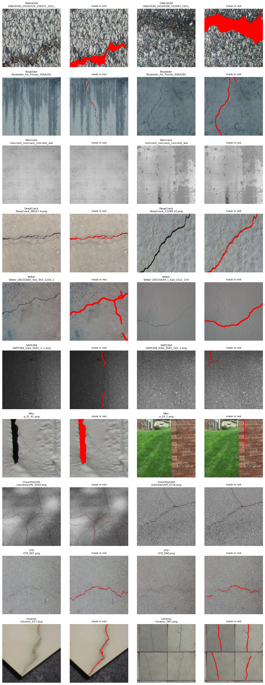
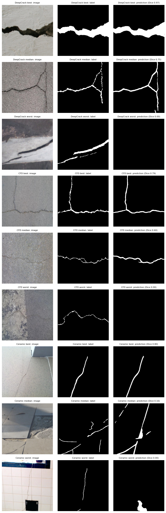
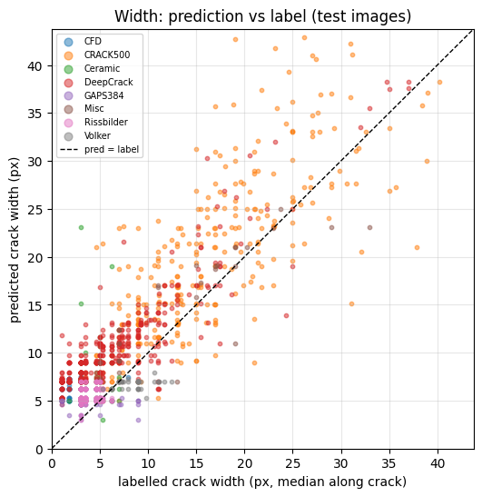
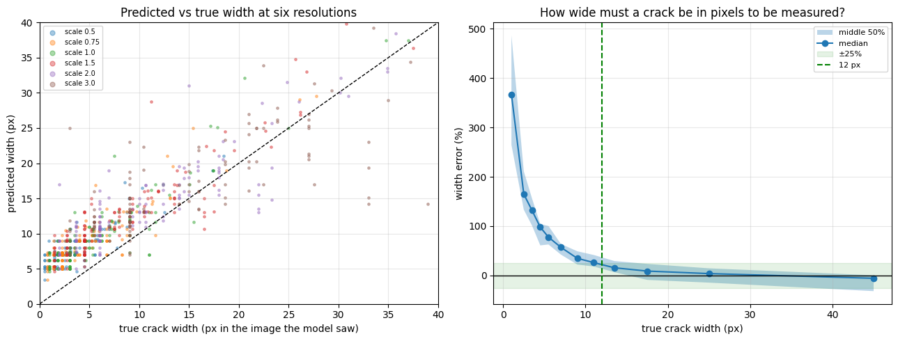

# Concrete crack segmentation and width measurement

> **Status: in progress.** Training, testing on unseen datasets, width measurement and the resolution study are complete (results below). **Still to do:** validation on field photographs of cracked buildings, measured by hand, and a simple web demo.

A U-Net finds cracks in photographs of concrete, and the predicted outline is turned into crack **length** and **width**. Because design codes judge cracks by width (Eurocode 2 recommends about 0.3 mm for most reinforced-concrete exposures), the project asks an engineering question rather than only "does it find cracks?": **can a segmentation model measure crack width well enough for inspection, and under what photographic conditions?**

## Main findings

1. **Detection transfers across cameras and labellers on concrete.** Dice 0.74 (95% CI 0.71–0.77) on held-out photographs from the training sources and **0.77 on DeepCrack**, a concrete dataset never used in training. 98–100% of cracked concrete and asphalt images are detected; 4.9% of crack-free walls raise a false alarm.
2. **It does not transfer to a new material.** Dice 0.60 on asphalt (CFD) and 0.29 on ceramic tiles, where grout lines and fittings are mistaken for cracks.
3. **Thin cracks are always drawn too wide.** The model never predicts a crack thinner than about 5–7 pixels, so thin cracks are over-widened by a roughly constant 2–4 px. On CFD the exact Dice is 0.60 but the 2-pixel-tolerant F1 is 0.87: the cracks are found, the edges are not.
4. **Width is reliable (median error within ±25%) only above about 12 px.** To judge a 0.3 mm crack, a photo therefore needs ≤ 0.025 mm per pixel: about **7 cm** from the wall with a 12 MP phone main camera, or **23 cm** with a 3× telephoto, each photo covering roughly a 10 cm strip.
5. **A width correction learned from one labelling style does not transfer to another.** Fitted on validation images (dominated by thick labels), it reduced the bias on thin-label datasets only from about +4 px to +2.7 px.
6. **The dataset's own split leaks.** In CrackSeg9k's official split, 79% of test photographs (690 of 869) have crops of the same original photo in the training set. All results here use a split by original photograph.

## Data

[CrackSeg9k](https://www.kaggle.com/datasets/atharv0919/crackseg9k) (Kulkarni et al., 2022): 9,159 images of 400 × 400 px with pixel masks, merged from ten earlier datasets. Images were traced back to their **parent photograph** from the file names (9,159 crops come from about 1,635 photographs).

| Split | Images | Sources | Purpose |
| --- | --- | --- | --- |
| train | 6,550 | CRACK500, Rissbilder, Noncrack, Volker, GAPS384, Misc | learning |
| val | 840 | same sources, different photographs | best epoch, threshold, width correction |
| test (seen sources) | 933 | same sources, different photographs | final score, used once |
| test (unseen sources) | 661 | DeepCrack, CFD, Ceramic | final score on data from other cameras and labellers |
| excluded | 175 | CrackTree200 | labels are one-pixel centre lines, incompatible with width measurement |

Label style differs strongly between sources (thick blobs in CRACK500, edge-tracing labels in DeepCrack and CFD, one-pixel lines in CrackTree200). A model learns whatever width its labels show, which turns out to be the central limitation for width measurement.

## Method

- **Model:** U-Net with an ImageNet-pretrained ResNet-34 encoder (24.4 M parameters), `segmentation-models-pytorch`.
- **Training:** random 384 px crops, flips, 90° rotations, brightness/contrast; loss = binary cross-entropy + Dice (cracks are about 3% of pixels); AdamW, learning rate 3×10⁻⁴ with cosine decay, 30 epochs, mixed precision on a Tesla T4 (~55 min). The best epoch by validation Dice was kept (0.750 at epoch 29).
- **Evaluation:** threshold chosen on validation only (0.35); Dice, IoU, precision, recall and 2-pixel-tolerant F1 on test; 95% bootstrap intervals resampling whole photographs.
- **Measurement:** the crack's centre line (skeleton) gives its length; the distance transform along the centre line gives local width (width = 2 × distance − 1). Checked on synthetic cracks of known width: accurate to ±0.5 px from 1 to 15 px.
- **Resolution study:** test images resized ×0.5 to ×3 to imitate the camera standing further away or closer, giving 840 measurements with known true width in pixels.

## Results

| Test group | Images | Dice (95% CI) | Precision | Recall | F1 ±2 px |
| --- | --- | --- | --- | --- | --- |
| Seen sources | 933 | 0.742 (0.712–0.772) | 0.71 | 0.78 | 0.85 |
| Unseen sources | 661 | 0.704 (0.664–0.738) | 0.62 | 0.81 | 0.86 |
| DeepCrack (concrete) | 443 | 0.771 (0.739–0.795) | 0.69 | 0.88 | 0.92 |
| CFD (asphalt) | 118 | 0.602 (0.581–0.621) | 0.49 | 0.78 | 0.87 |
| Ceramic (tiles) | 100 | 0.290 (0.235–0.350) | 0.27 | 0.32 | 0.38 |

**Width.** Median predicted vs labelled crack width per test image:

**How wide must a crack be to be measured?**

| True width in the image | Median width error |
| --- | --- |
| 2–3 px | +165% |
| 6–8 px | +57% |
| 10–12 px | +26% |
| 12–15 px | +16% |
| 20–30 px | +4% |

Full tables are in [`results/`](results).

## Limitations

- One training run (seed 0); repeat runs for error bars across seeds are planned.
- "Truth" for width is the dataset labels, whose style varies by source; hand measurements on real cracks (in progress) are the proper reference.
- The resolution study simulates distance by resizing images. Enlarged images are blurrier than genuine close-ups, and real phone photos lose sharpness to focus and compression, so the camera distances are approximate until checked on real photographs.
- Concrete and asphalt only; the model fails on tiles.

## Next steps

1. **Field validation (in progress):** 15–20 cracks in local buildings, each photographed at three distances with a ruler in frame for scale, and widths measured by hand with a feeler gauge.
2. Thinner predictions for thin cracks: training on edge-tracing labels, a boundary-aware loss, or sub-pixel width estimated from the probability profile across the crack.
3. A web demo: upload a photo, get the crack outline, length and width, with the width limits above shown alongside.

## Reproduce

The notebooks in [`notebooks/`](notebooks) were run on Kaggle (Tesla T4) with the CrackSeg9k dataset attached, in order:

| Notebook | What it does | Hardware |
| --- | --- | --- |
| `stage0_explore` | sources, parent photos, label styles, leakage in the official split | CPU |
| `stage1_data_pipeline` | splits by parent photograph, augmentation, data loaders | CPU |
| `stage2_model_and_loss` | U-Net, loss comparison, overfit-one-batch check | CPU |
| `stage3_training` | 30-epoch training run | GPU |
| `stage4_evaluation` | threshold on validation, seen vs unseen test, bootstrap, false alarms | GPU |
| `stage5_measurement` | length and width measurement, bias and correction | GPU |
| `stage6_resolution` | minimum measurable width, camera-distance rule | GPU or CPU |

Stages 4–6 read the trained weights from the Stage 3 notebook's output. The weights (98 MB) are not stored in this repository.

## Author

Richard Olanite · Berm Engineering and Consulting Ltd · [github.com/thatboypage](https://github.com/thatboypage)
